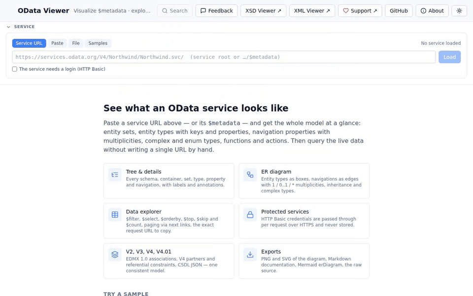

# OData Online Viewer

[](https://www.odata-viewer.online/?utm_source=github&utm_medium=readme)

**See what an OData service contains, how its entities relate, and what data it returns —
right in your browser. No install, no account, nothing stored.**

Open <https://www.odata-viewer.online>, paste the URL of an OData service (or its `$metadata`),
and the viewer turns the raw EDMX into a browsable tree, an entity-relationship diagram and a
live data explorer. Works with OData V2, V3, V4 and V4.01 — SAP Gateway, Microsoft Dynamics,
SharePoint, Business Central and any other OData API.



## What it's good for

- **Understanding an unfamiliar service.** A `$metadata` document of a real system easily runs to
  thousands of lines of XML. The viewer shows which entity sets exist, what their keys and
  properties are, how they are connected and which functions and actions they offer — with
  SAP labels and descriptions where the service provides them.
- **Seeing the data model at a glance.** The ER diagram draws entity types and their navigations
  with `1 / 0..1 / *` multiplicities, so you can follow `Order → Customer → …` without reading a
  line of XML.
- **Trying out queries before you code them.** Build `$filter`, `$select`, `$orderby` or
  `$expand` in a form, look at the result, and copy the exact request URL into Excel, Power BI,
  Postman, curl or your own code.
- **Getting data out.** Export the rows you see — or all matching rows — to Excel, with numbers
  and dates as real numbers and dates.
- **Documenting a service.** Generate Markdown documentation or a Mermaid `erDiagram` for a wiki,
  a ticket or a design document, or save the diagram as PNG/SVG.
- **Talking about a service.** Every entity, property and view has a link you can share with a
  colleague.

## What you can do with it

- **Load a service any way you like** — by URL (service root or `…/$metadata`), by pasting the
  document, or by uploading an EDMX/CSDL file (XML or JSON). Services behind a login work with
  HTTP Basic authentication. Not sure where to start? Try one of the built-in samples
  (Northwind, TripPin and others).
- **Browse the model** — schemas, entity sets, singletons, entity/complex/enum types, functions,
  actions and imports in a searchable tree (Ctrl+K). The details panel shows keys, types, facets,
  labels, annotations, inherited members and where a type is used.
- **Explore the diagram** — pan, zoom, focus on one entity and its neighbours in big models,
  toggle properties and complex types, export as PNG or SVG.
- **Query live data** — pick an entity set, set query options, page through the results, sort by
  clicking a column header, follow foreign keys and navigations to related records.
- **Read the source** — the original `$metadata` with syntax highlighting; jump from any node to
  its line.
- **Use it anywhere** — light and dark mode, and a layout that works on phones and tablets too.

## Your data stays with you

- **Nothing is stored.** Metadata is parsed in memory and dropped from a short-lived cache. Query
  results go straight to your browser.
- **Credentials are never kept.** Login data is only sent over HTTPS, passed on with each request
  and forgotten when you close the tab.
- **No account, no login, no tracking scripts.**
- **You can run it yourself.** The whole app is a single Docker container — see
  [Self-host with Docker](#self-host-with-docker) below, e.g. to reach services inside your
  company network.

## Self-host with Docker

Keep credentials inside your network, or reach on-premise services (SAP Gateway, intranet APIs)
that the public site cannot:

```bash
docker run --rm -p 8080:8080 ghcr.io/karlkauc/odata-online-viewer:latest
```

Then open <http://localhost:8080>. Configuration options are listed in
[docs/TECHNICAL.md](docs/TECHNICAL.md).

## No warranty

This tool is offered free of charge and **without any warranty**. The visualisation is a
best-effort rendering of the service description; always check the authoritative service before
relying on it for production decisions. Use is at your own risk.

## Found a bug? Missing a feature?

Please open an issue on GitHub — bug reports, reproduction steps and feature requests are all
welcome, or use the *Feedback* button in the app:

➡️ <https://github.com/karlkauc/odata-online-viewer/issues>

## Technical details, self-hosting & development

Architecture, security, configuration, the HTTP API, deployment and the local development
setup are described in **[docs/TECHNICAL.md](docs/TECHNICAL.md)**.

## Sister tools

- [XSD Online Viewer](https://www.xsd-viewer.online) — visualise XML schemas.
- [XML Online Viewer](https://www.xml-viewer.online) — read XML and validate it against an XSD.

## License

MIT — © 2026 Karl Kauc. Sample metadata documents are snapshots of public demo services
(services.odata.org) included for offline use and tests.

## Author

Built and maintained by **Karl Kauc** — [github.com/karlkauc](https://github.com/karlkauc).
